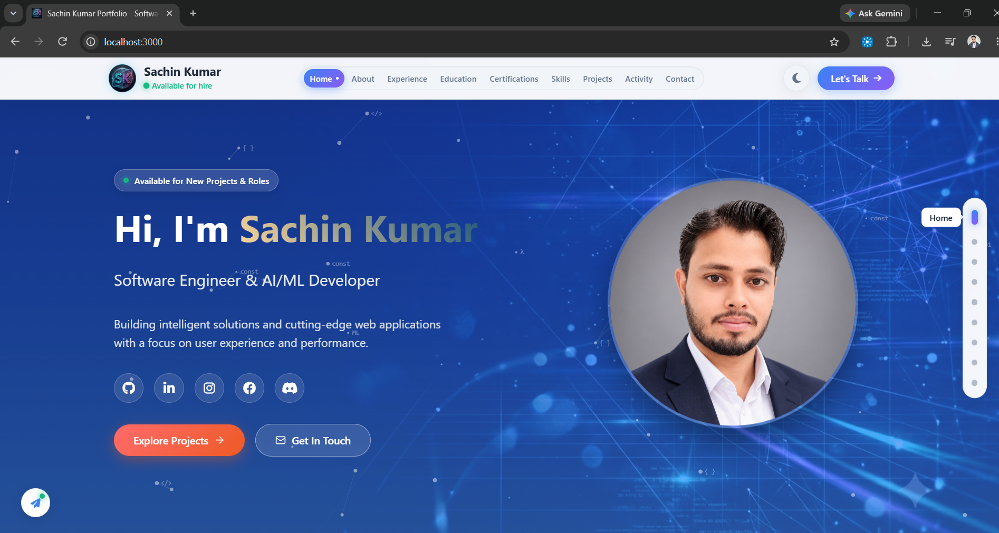

# Sachin Kumar - Portfolio Website (React + JavaScript)



A modern, responsive portfolio website for **Sachin Kumar**, Software Engineer & AI/ML Developer, built with **React 18**, **JavaScript (ESNext / JSX)**, and **Vite**.

## 🚀 Features

- ⚛️ **Modern React Architecture** - Component-based SPA using React 18 & JavaScript (JSX).
- ⌨️ **Dynamic Typing Animation** - Authentic typing effect for name and cycling roles (Software Engineer & AI/ML Developer, Full Stack Developer, Problem Solver, etc.).
- 📜 **Interactive Certificate Viewer Modal** - In-page modal preview and direct download for 20+ certificates across Web Dev, AI/ML, ISRO, and internships.
- 🏷️ **Categorized Certifications & Filter Tabs** - Filter through all certifications by topic with one click.
- 🐙 **GitHub Contributions Section** - Real-time activity timeline, public repositories, and commit tracker fetched live via the GitHub API.
- 📊 **Animated Scroll Progress Bar** - Thin, gradient-animated progress bar at the very top tracking viewport position.
- 🌓 **Dark & Light Mode Toggle** - Instant theme switcher persisting preferences across sessions via CSS variables.
- 📱 **Fully Responsive** - Polished mobile drawer menu, adaptive grid layouts, and touch-friendly controls.
- ✉️ **Functional Contact Form** - Live client-side email & required field validation with Formspree endpoint integration and feedback states.
- 🛠️ **Skills & Projects Showcase** - Interactive skill badges, featured project cards with live links, GitHub access, and in-browser JS code viewer.

## 🛠️ Tech Stack

- **Framework**: React 18, JavaScript (ES6+ / JSX), Vite
- **Styling**: Modern CSS with CSS custom properties, smooth scrolling, keyframe animations, and responsive flex/grid layouts
- **Icons**: Font Awesome 6
- **Hosting / Dev**: Vite dev server on port 3000

## 📁 Project Structure

```
├── public/
│   ├── certificates/      # PDF & image certificates
│   ├── images/            # Profile photos & project screenshots
│   ├── projects.js        # Global projects JavaScript file
│   └── favicon.svg        # SVG favicon
├── src/
│   ├── components/        # React JSX components (Navbar.jsx, Hero.jsx, etc.)
│   ├── data/              # JavaScript data modules (portfolioData.js, projects.js)
│   ├── index.css          # Global styling, themes, & animations
│   ├── App.jsx            # Main app shell & section reveal observer
│   └── main.jsx           # React DOM root entry
├── index.html             # HTML entry point with metadata
├── package.json           # Dependencies and scripts
├── jsconfig.json          # JavaScript project configuration
└── vite.config.js         # Vite build configuration
```

## 🏃 Running the App

```bash
# Install dependencies
npm install

# Start development server
npm run dev

# Build for production
npm run build
```

---

**Built with ❤️ by Sachin Kumar**
